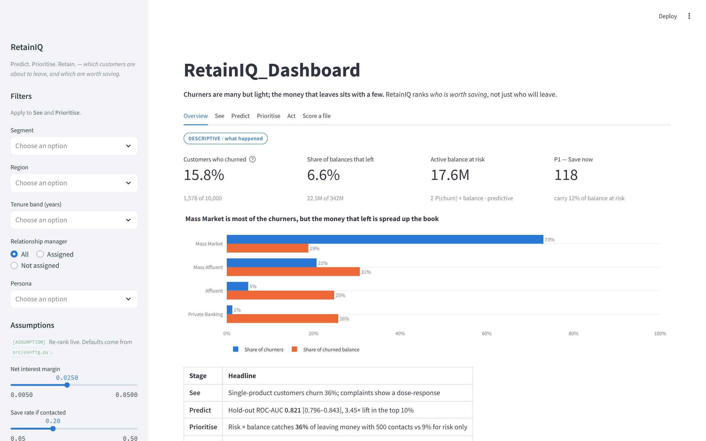
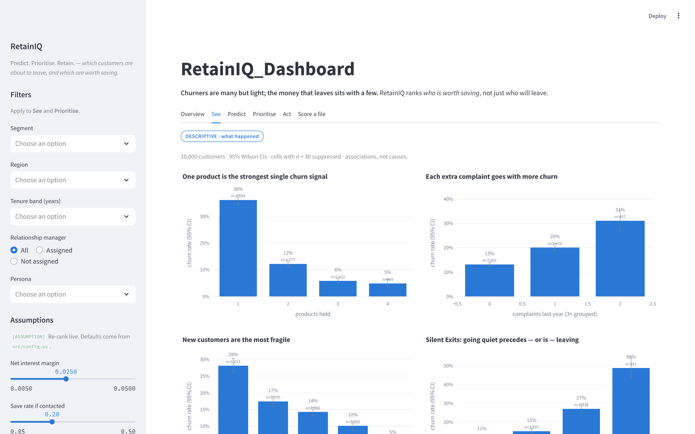
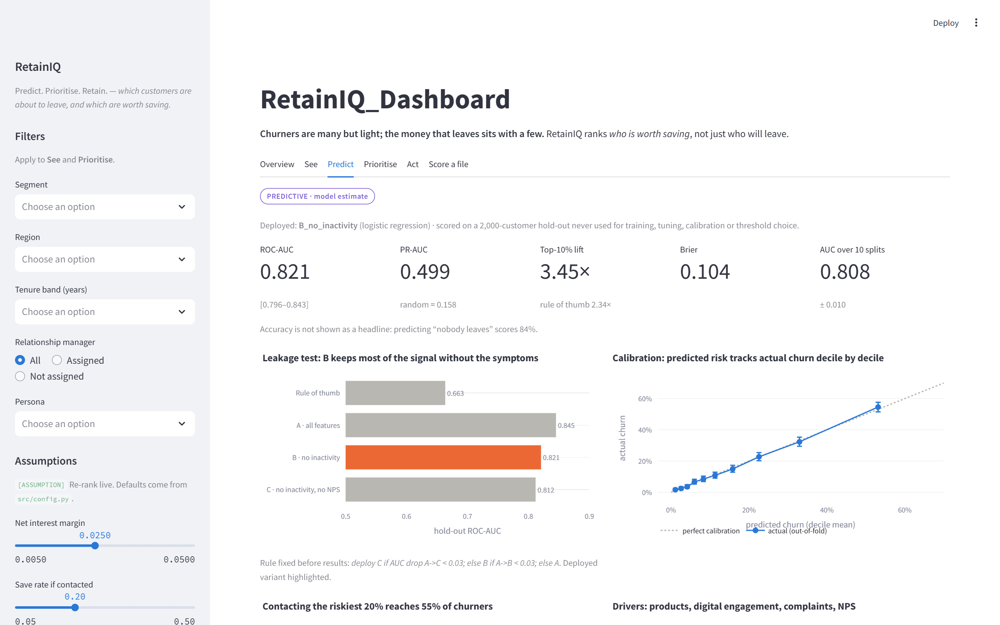
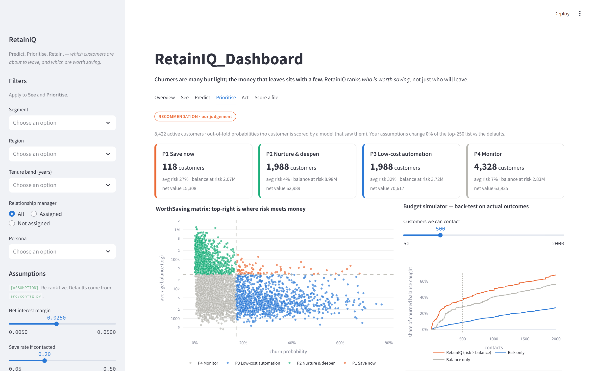
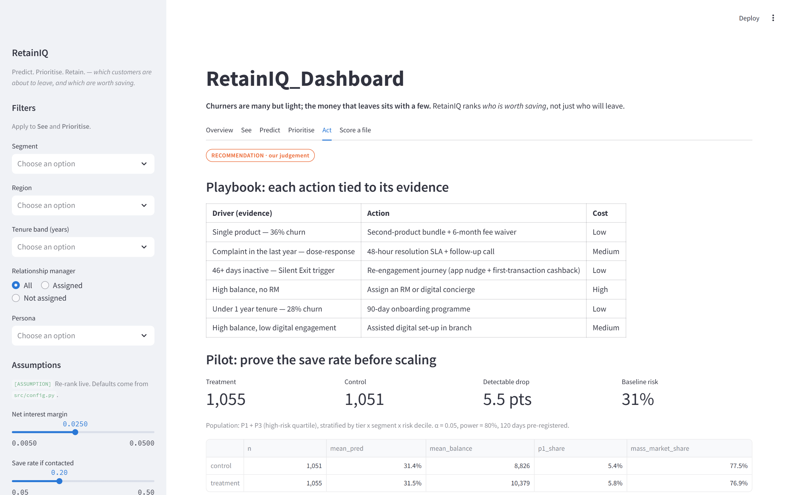
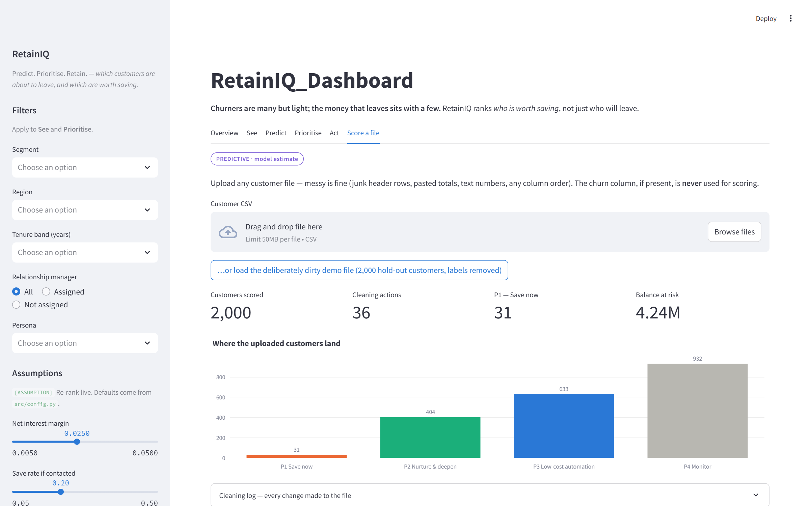

# RetainIQ: Predict. Prioritise. Retain.

[](https://www.python.org/)
[](https://scikit-learn.org/)
[](https://streamlit.io/)
[](https://github.com/)
[](https://github.com/)

> **Value-Driven Customer Churn Prediction & Retention Prioritization System**  
> *Developed for the Meridian Trust Bank Management Committee*

---

## 📌 What is RetainIQ?

Traditional bank churn models ask: **"Who will leave?"**  
At Meridian Trust Bank, answering that question alone wastes retention budgets:

* **15.8% of customers churned** (1,578 of 10,000 customers).
* Those churners held **only 6.6%** of total bank deposits.
* **73% of churners are Mass Market**, but they took just **19%** of the churned money.
* The **top balance quintile is only 7% of churners, but holds 56% of leaving balances**.

Spending retention budget purely on churn risk protects **headcount rather than deposits**.  
**RetainIQ changes the question to: "Who is worth saving?"**

RetainIQ combines calibrated machine learning probabilities with customer deposit balances to calculate **Balance at Risk** and **Net Retention Value**, routing every customer into actionable operational tiers.

---

## 🔄 Project Workflow

The end-to-end system follows a structured, vertically aligned workflow that transforms raw, messy bank extracts into high-impact retention decisions:

```mermaid
flowchart TD
    Step1["<b>1. Ingestion & Sanitization</b><br/>• Ingests 10,020 raw lines and extracts 10,000 clean customer accounts.<br/>• Removes junk headers and 18 summary rows (preventing 342M phantom balance).<br/>• Converts 9,895 text numbers with commas into numeric datatypes.<br/>• Identifies logic anomalies (product mismatches, tenure flags) without dropping records."]
    --> Step2["<b>2. Predictive Churn Modeling</b><br/>• Trains an L2-regularized classifier with 5-fold Platt Sigmoid calibration.<br/>• Verified Hold-out ROC-AUC of <b>0.821</b> and PR-AUC of <b>0.499</b> (vs. 0.158 baseline).<br/>• <b>Data Leakage Audited</b>: Excludes inactivity days so the bank acts <i>before</i> accounts go quiet.<br/>• Generates top 3 plain-English reason codes per account from log-odds contributions."]
    --> Step3["<b>3. Economic Prioritisation Engine</b><br/>• Prioritises active customers by financial exposure rather than probability alone:<br/>   <b>Balance at Risk</b> = P(churn) × Average Monthly Balance<br/>• Computes <b>Net Retention Value</b> based on 3-year horizon, 2.5% Net Interest Margin, and 20% save rate."]
    --> Step4["<b>4. The WorthSaving 2×2 Matrix</b><br/>• <b>P1 Save Now</b> (High Risk, High Value) → Relationship Manager outreach in 5 days + custom offer<br/>• <b>P2 Nurture & Deepen</b> (Low Risk, High Value) → Loyalty perks & second-product cross-sell<br/>• <b>P3 Low-Cost Automation</b> (High Risk, Low Value) → In-app automated digital re-engagement<br/>• <b>P4 Monitor</b> (Low Risk, Low Value) → Passive monitoring with $0 marketing spend"]
    --> Step5["<b>5. Operations & Executive Delivery</b><br/>• Interactive Streamlit Executive Dashboard (6 tabs with dynamic scenario modeling).<br/>• Top-200 RM priority call roster capturing <b>26% of all active balance at risk</b>.<br/>• Pre-registered 120-Day Stratified A/B RCT Pilot design (2,106 customers, 5.5 pp MDE)."]

    style Step1 fill:#f8fafc,stroke:#64748b,stroke-width:2px
    style Step2 fill:#eff6ff,stroke:#3b82f6,stroke-width:2px
    style Step3 fill:#f0fdf4,stroke:#22c55e,stroke-width:2px
    style Step4 fill:#fefce8,stroke:#eab308,stroke-width:2px
    style Step5 fill:#faf5ff,stroke:#a855f7,stroke-width:2px
```



---

## 🖥️ Interactive Dashboard Showcase

The RetainIQ dashboard (`app/retainiq_app.py`) provides an executive interface with dynamic scenario modeling. Below is a walkthrough of each of the 6 modules:

### 1. Executive Overview & Business Thesis

*Provides headline KPIs, the volume vs. value paradox, deposit quintile distributions, and interactive sensitivity sliders (Net Interest Margin, Save Rate, Contact Costs) to re-evaluate portfolio economics on the fly.*

---

### 2. Churn Discovery & Behavioral Evidence ("See")

*Explores statistical churn drivers with 95% confidence intervals, including the dose-response complaints curve ($z=12.5$), single vs. multi-product churn gap (36.1% vs. 8.8%), and Relationship Manager confounding analysis.*

---

### 3. Model Prediction, Calibration & Fairness ("Predict")

*Displays holdout ROC/PR curves (AUC: 0.821), the 3-way data leakage experiment, Platt reliability curve (Brier score: 0.104), and demographic fairness audits demonstrating zero disparate impact across gender and region.*

---

### 4. Prioritisation Engine & The WorthSaving Matrix ("Prioritise")

*Allocates all 8,422 active customers across the 2×2 WorthSaving matrix (P1–P4), features an interactive contact budget simulator, cumulative gain curves, and customer drill-down cards with top 3 plain-English reason codes.*

---

### 5. Operational Playbook & 120-Day RCT Pilot ("Act")

*Maps 6 evidence-based interventions to specific churn drivers with unit costs, alongside sample size calculations and statistical power curves for the pre-registered 120-day A/B pilot (2,106 customers, 5.5 pp MDE).*

---

### 6. Batch Scoring Engine ("Score a File")

*Enables bank analysts to upload raw or corrupted CSV files for automated sanitization and instant batch scoring, generating downloadable ranked customer rosters with recommended actions and reason codes.*

---

## 📈 Model Performance & Accuracy

### Why Naive Accuracy is Misleading
* Churn is imbalanced (**15.8% base rate**).
* A dummy model predicting *"nobody ever leaves"* scores **84.2% accuracy**, but identifies **0 churners** and saves **$0**.
* RetainIQ evaluates performance using **ROC-AUC, PR-AUC, Decile Lift, Brier Score**, and **Leaving Money Caught**.

### Verified Hold-Out Results ($n = 2,000$ unseen test customers)

| Metric | RetainIQ Score | Benchmark / Context |
|---|:---:|---|
| **Hold-out ROC-AUC** | **0.821** [0.796–0.843] | 10 random splits average: $0.808 \pm 0.010$ |
| **Hold-out PR-AUC** | **0.499** [0.444–0.554] | Baseline random ranking is **0.158** |
| **Top 10% Risk Lift** | **3.45×** | Captures **34.5% of all churners** in the top decile |
| **Calibration (Brier Score)** | **0.104** | Mean prediction 16.3% vs. 15.8% actual |
| **Rule-of-Thumb Baseline** | **0.663** ROC-AUC | Simple complaints + inactivity heuristic (RetainIQ beats it by 47%) |
| **Unseen Dirty File AUC** | **0.821** | 99.85% identical scores on corrupted test file |

### Data Leakage Test & Deployed Variant
Inactivity (`last_transaction_days_ago`) is often a *symptom* of leaving rather than an early sign:
* **Variant A** (All features): ROC-AUC **0.845**
* **Variant B (DEPLOYED)**: Excludes `last_transaction_days_ago` $\to$ ROC-AUC **0.821**
* **Variant C** (Excludes inactivity and NPS): ROC-AUC **0.812**

> **Variant B was selected for deployment**: It warns the bank *before* a customer goes quiet. Inactivity is moved to the operational playbook as a live "Silent Exits" trigger.

---

## 💰 The WorthSaving Matrix & Back-Test Proof

RetainIQ ranks only active accounts using out-of-fold calibrated probabilities:

```
                          HIGH RISK (Top 25%)           LOWER RISK (Bottom 75%)
                     ┌─────────────────────────────┬─────────────────────────────┐
   HIGH VALUE        │ P1: SAVE NOW (118 accts)    │ P2: NURTURE & DEEPEN (1,988)│
   (Top 25% Balance  │ 27% Risk · 12% Bal at Risk  │ 4% Risk · 51% Bal at Risk   │
    >= $28,796)      │ RM call in 5d + custom offer│ Cross-sell & VIP perks      │
                     ├─────────────────────────────┼─────────────────────────────┤
   LOWER VALUE       │ P3: AUTOMATION (1,988 accts)│ P4: MONITOR (4,328 accts)   │
   (Bottom 75%       │ 32% Risk · 21% Bal at Risk  │ 7% Risk · 16% Bal at Risk   │
    Balance)         │ Low-cost digital app nudges │ Passive monitoring, $0 spend│
                     └─────────────────────────────┴─────────────────────────────┘
```

### Decisive Historical Back-Test (Budget = 500 Customer Contacts)

| Ranking Rule | Churned Balance Caught | Churners Caught | Business Impact |
|---|:---:|:---:|---|
| **RetainIQ (Risk × Balance)** | **36%** | 96 | **Catches 4× more leaving money** by prioritizing value |
| **Risk Only** | **9%** | 317 | Catches many churners, but misses where the deposits are |
| **Balance Only** | **28%** | 21 | Misses high-risk customers, wasting calls on loyal accounts |

---

## 🧹 Data Overview & Structural Cleaning

The raw data (`data/raw/Bank_Data.csv`) contained **10,020 rows** with structural issues that would distort standard models:

* **18 Pasted Pivot/Summary Rows Removed**: Rows like `"Total, 10000"` and `"Average, 5.2"` were stripped, eliminating **342 Million in phantom balance**.
* **1 Junk Header Row Skipped**: Automatically detected and bypassed by the ingestion engine.
* **9,895 Text Numbers Parsed**: Values formatted with commas (e.g., `"1,18,776"`) converted to clean numeric datatypes.
* **Redundant Columns Removed**: Dropped ambiguous `Aging` column and 1 unnamed blank column.
* **Logic Issues Flagged (Never Silently Deleted)**:
  * 199 rows where product flags exceeded `num_products` (`flag_product_mismatch`).
  * 1,009 rows where tenure exceeded adult life (`flag_tenure_gt_age`).
  * 157 incomes floored at 1,500 and 1,870 credit scores capped at 850 ceiling.
* **Final Result**: Exactly **10,000 clean customers, 0 missing values, and 0 duplicate IDs**.

---

## 🛠️ Technology Stack

| Category | Tools & Libraries |
|---|---|
| **Language & Runtime** | Python `3.13.5` |
| **Machine Learning** | `scikit-learn` (1.6.1), `lightgbm` (4.7.0), `imbalanced-learn` (0.13.0) |
| **Explainability & Stats** | `shap` (0.54.1), `statsmodels` (0.14.4), `scipy` (1.15.3) |
| **Data Processing** | `pandas` (2.2.3), `numpy` (2.1.3), `joblib` (1.4.2), `openpyxl` (3.1.5) |
| **UI & Visualizations** | `streamlit` (1.45.1), `plotly` (5.24.1), `matplotlib` (3.10.0) |
| **Notebook Automation** | `nbformat` (5.10.4), `nbconvert` (7.16.6), `ipykernel` (6.30.1) |

---

## 🚀 How to Run the Project

Follow these step-by-step commands for Windows PowerShell or Command Prompt (CMD).

### 1. Environment Setup

#### 🔹 Windows PowerShell
```powershell
# Navigate to the project root
cd "d:\IES Hackathon\RetainIQ"

# Create virtual environment
python -m venv venv

# Enable script execution in current PowerShell session
Set-ExecutionPolicy -ExecutionPolicy RemoteSigned -Scope Process

# Activate virtual environment
.\venv\Scripts\Activate.ps1

# Install pinned dependencies
python -m pip install --upgrade pip
pip install -r requirements.txt
```

#### 🔹 Windows Command Prompt (CMD)
```cmd
:: Navigate to the project root
cd /d "d:\IES Hackathon\RetainIQ"

:: Create virtual environment
python -m venv venv

:: Activate virtual environment
call venv\Scripts\activate.bat

:: Install pinned dependencies
python -m pip install --upgrade pip
pip install -r requirements.txt
```

---

### 2. Run the End-to-End Pipeline
Reproduces all data cleaning, models, evaluations, backtests, and charts in one run (~100 seconds):

```bash
python src/run_all.py
```

---

### 3. Launch the Interactive Dashboard
Opens the 6-tab Streamlit executive dashboard in your web browser (`http://localhost:8501`):

```bash
streamlit run app/retainiq_app.py
```

---

### 4. Score Unseen / Custom CSV Files via CLI
The inference script automatically sanitizes and scores any new CSV file:

```bash
python src/predict.py --input data/demo/holdout_dirty.csv --output outputs/scored_customers.csv
```

Outputs include: `customer_id`, `churn_probability`, `risk_tier`, `priority_tier`, `balance_at_risk`, `net_retention_value`, `priority_rank`, `top_reasons`, and `recommended_action`.

---

### 5. Rebuild Evidence Notebooks (Optional)
Re-executes the four evidence Jupyter notebooks:

```bash
python src/make_notebooks.py
```

---

## 📁 Repository Structure

```
RetainIQ/
├── app/
│   └── retainiq_app.py              # 6-tab interactive Streamlit dashboard
├── data/
│   ├── raw/Bank_Data.csv            # Original untouched raw dataset
│   ├── cleaned_bank_data.csv        # 10,000 sanitized customer records
│   └── demo/                        # Unlabelled and dirty demo files
├── notebooks/                       # 4 executed evidence Jupyter notebooks
├── outputs/
│   ├── dashboard_screenshots/       # High-res screenshots of dashboard tabs
│   ├── figures/                     # 18 publication-quality charts (PNG)
│   ├── retainiq_model.pkl           # Trained and calibrated model bundle
│   ├── ranked_customers.csv         # Prioritized list of active customers
│   ├── metrics.json                 # Complete evaluation metrics and CIs
│   └── prioritisation_results.json  # Backtest numbers and gain curves
├── reports/
│   ├── management_report.md         # Management Committee executive report
│   ├── model_card.md                # Technical model specification & audit
│   └── judge_qa.md                  # Defended questions and answers
├── src/
│   ├── run_all.py                   # Master reproduction script
│   ├── clean.py                     # Data cleaning and validation logic
│   ├── eda.py                       # Hypothesis testing & K-Means clustering
│   ├── train.py                     # Model tournament & Platt calibration
│   ├── prioritise.py                # WorthSaving matrix & back-testing
│   ├── pilot_power.py               # 120-day RCT pilot power sizing
│   └── predict.py                   # CLI scoring engine for new CSV files
├── requirements.txt                 # Pinned dependencies
└── README.md                        # Project documentation
```

---

<p align="center">
  <b>RetainIQ · Predict. Prioritise. Retain.</b><br>
  <i>Meridian Trust Bank Management Committee</i>
</p>
