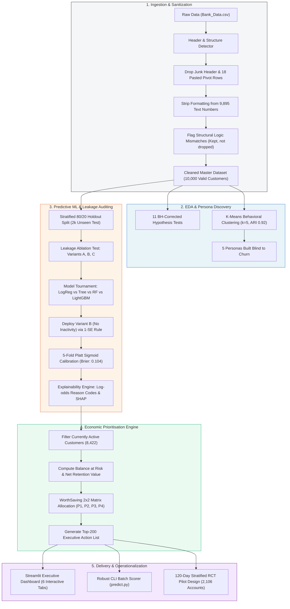

# RetainIQ: Predict. Prioritise. Retain.

[](https://www.python.org/)
[](https://scikit-learn.org/)
[](https://streamlit.io/)
[](https://github.com/)
[](https://github.com/)
[](https://github.com/)

> **Enterprise Customer Churn Prediction & Value-Driven Retention Prioritization System**  
> *Prepared for the Meridian Trust Bank Management Committee*

---

## 📌 Table of Contents
1. [Executive Summary & Core Thesis](#-executive-summary--core-thesis)
2. [End-to-End System Architecture & Flowchart](#-end-to-end-system-architecture--flowchart)
3. [Interactive Dashboard Walkthrough & Screenshots](#-interactive-dashboard-walkthrough--screenshots)
4. [Complete Technology Stack](#-complete-technology-stack)
5. [Data Hygiene, Structural Cleaning & Volume Breakdown](#-data-hygiene-structural-cleaning--volume-breakdown)
6. [Exploratory Data Analysis & Behavioral Drivers](#-exploratory-data-analysis--behavioral-drivers)
7. [Machine Learning Pipeline, Accuracy & Model Validation](#-machine-learning-pipeline-accuracy--model-validation)
8. [Prioritisation Engine: The "WorthSaving" Matrix](#-prioritisation-engine-the-worthsaving-matrix)
9. [Actionable Playbook & Randomized Controlled Trial (RCT)](#-actionable-playbook--randomized-controlled-trial-rct)
10. [Step-by-Step Execution Guide (PowerShell & CMD)](#-step-by-step-execution-guide-powershell--cmd)
11. [CLI Inference Engine (Scoring Dirty / Unseen Files)](#-cli-inference-engine-scoring-dirty--unseen-files)
12. [Repository & Deliverables Map](#-repository--deliverables-map)
13. [Model Governance, Fairness & Monitoring](#-model-governance-fairness--monitoring)

---

## 💡 Executive Summary & Core Thesis

Traditional bank churn solutions ask a single question: **"Who will leave?"**  
At Meridian Trust Bank, this question leads to massive misallocation of retention capital.

### The Volume vs. Value Paradox
* **15.8% of customers churned** (1,578 out of 10,000 customers; 95% Wilson CI: 15.1%–16.5%).
* Those churners held **only 6.6%** of total bank deposit balances.
* **73% of churners belong to Mass Market**, yet they took just **19%** of the churned balances.
* Conversely, the **top balance quintile (Q5) represents only 7% of churners, but commands 56% of total churned balances**.

```
WHERE THE CHURNERS ARE (VOLUME)          WHERE THE LEAVING MONEY IS (VALUE)
┌─────────────────────────────────────┐  ┌─────────────────────────────────────┐
│ Mass Market: 73% of all churners    │  │ Mass Market: 19% of leaving balances│
│ Top Balance Q5: 7% of churners      │  │ Top Balance Q5: 56% of balances     │
└─────────────────────────────────────┘  └─────────────────────────────────────┘
```

> ⚠️ **Key Strategic Takeaway:**  
> A naive model optimized solely for churn probability ($P(\text{churn})$) fills relationship managers' call lists with zero-balance or low-balance accounts. Spending retention budgets on them protects **headcount rather than deposits**.

### The RetainIQ Paradigm: "Who is Worth Saving?"
RetainIQ shifts the paradigm from pure risk classification to **economic value preservation**:
1. **Balance at Risk**:
   $$\text{Balance at Risk} = P(\text{churn}) \times \text{Average Monthly Balance}$$
2. **Net Retention Value (NRV)**:
   $$\text{Net Retention Value} = P(\text{churn}) \times \text{Annual Value} \times \text{Horizon (3 yrs)} \times \text{Save Rate (20\%)} - \text{Intervention Cost}$$
   *Where $\text{Annual Value} = (\text{Balance} \times 2.5\% \text{ Net Interest Margin}) + (\$50 \times \text{Products Held})$.*
3. **The Empirical Proof (Back-Test on 10,000 Accounts)**:  
   Given an operational capacity of **500 customer outreach contacts**, RetainIQ captures **36% of the leaving deposits** ($2,008,249 balance caught) compared to just **9%** for probability-only ranking.  
   **RetainIQ delivers a 4× multiplier in protected deposits.**

---

## 🔄 End-to-End System Architecture & Flowchart

The system runs deterministically end-to-end via `python src/run_all.py` with reproducible seed `42` and strict PASS/FAIL assertion gates.



---

## 🖥️ Interactive Dashboard Walkthrough & Screenshots

The RetainIQ dashboard (`app/retainiq_app.py`) is an enterprise-grade UI built with Streamlit and Plotly. It reads pipeline artifacts directly and supports dynamic recalculation of retention economics.

### Tab 1: Executive Overview & Business Thesis
Provides KPI scorecards, deposit concentration metrics, and the core rationale proving why volume churn does not equate to value loss.

*Features: Churn volume vs. value cards, quintile breakdown, dynamic parameter sidebar (NIM, Save Rate, Contact Costs).*

---

### Tab 2: Churn Discovery & Behavioral Evidence ("See")
Explores statistical associations with churn, verified using Benjamini-Hochberg false-discovery-rate correction and 95% confidence intervals.

*Features: Dose-response complaints curve ($z=12.5$), single vs. multi-product drop-off, tenure curve, and the RM confounding breakdown.*

---

### Tab 3: Model Prediction, Calibration & Fairness ("Predict")
Presents rigorous model audit results, the three-way data leakage experiment, Platt reliability curve, and demographic fairness audits.

*Features: Holdout ROC-AUC / PR-AUC, Brier score reliability diagram, and gender/region parity tables.*

---

### Tab 4: Prioritisation Engine & The WorthSaving Matrix ("Prioritise")
Ranks the 8,422 active customers into four operational tiers, providing an interactive budget simulator, full list exports, and instant customer cards.

*Features: Interactive 2×2 WorthSaving matrix, cumulative balance gain curve, and customer drill-down card with reason codes.*

---

### Tab 5: Operational Playbook & Randomized Pilot ("Act")
Defines exact intervention pathways mapped to behavioral evidence and provides sample size and statistical power calculations for an A/B RCT pilot.

*Features: Six evidence-based intervention playbooks, pre-registered 120-day RCT power curves (MDE: 5.5 pp), and guardrail metrics.*

---

### Tab 6: Batch Scoring Engine ("Score a File")
Allows bank analysts to upload any raw, unlabelled, or deliberately corrupted CSV file to run automated cleaning, feature engineering, and inference in real time.

*Features: Live file sanitization log, instant preview of top at-risk balances, and downloadable scored customer rosters.*

---

## 🛠️ Complete Technology Stack

| Layer | Technology | Version | Purpose in RetainIQ |
|---|---|---|---|
| **Runtime** | Python | `3.13.5` | Core programming runtime environment |
| **Data Ingestion & Wrangling** | Pandas | `2.2.3` | High-performance tabular transformation, sanitization, and aggregation |
| **Numerical Processing** | NumPy | `2.1.3` | Vectorized operations, custom loss evaluations, and seed generation |
| **Statistical Inference** | Statsmodels | `0.14.4` | Benjamini-Hochberg FDR correction, adjusted odds ratios, and logistic regressions |
| **Scientific Computing** | SciPy | `1.15.3` | Statistical hypothesis testing, Wilson score intervals, and power sizing |
| **Machine Learning Core** | Scikit-Learn | `1.6.1` | Stratified K-fold, Logistic Regression, Decision Trees, Random Forests, Platt scaling |
| **Gradient Boosting** | LightGBM | `4.7.0` | Non-linear benchmarking model and comparator |
| **Model Interpretability** | SHAP | `0.54.1` | Shapley additive feature importance analysis |
| **Class Imbalance** | Imbalanced-Learn | `0.13.0` | Sampling strategy benchmarking (SMOTE / Random Undersampling) |
| **Interactive UI** | Streamlit | `1.45.1` | Multi-tab executive dashboard with live recalculation sliders |
| **Data Visualization** | Plotly | `5.24.1` | Interactive charts, scatter plots, and gain curves |
| **Static Plotting** | Matplotlib | `3.10.0` | Publication-ready figures and risk matrix visualizations |
| **Model Persistence** | Joblib | `1.4.2` | Serialization of pipeline bundles and calibrated models |
| **File Formats** | OpenPyXL | `3.1.5` | Excel workbook ingestion and export capabilities |
| **Notebook Tooling** | nbformat / nbconvert | `5.10.4` / `7.16.6` | Programmatic building and execution of analytical notebooks |

---

## 🧹 Data Hygiene, Structural Cleaning & Volume Breakdown

The raw input file (`data/raw/Bank_Data.csv`) contained **10,020 rows** with severe real-world data corruption that would completely break standard analytics pipelines if ingested naively.

### 1. Structural Corruption Identified & Fixed
* **Junk Header Row**: 1 junk descriptive line above the header (`"RetainIQ extract,,,"`) detected and skipped via automated header sniffing.
* **18 Pasted Pivot/Summary Rows**: Contained values like `"Total, 10000"`, `"Average, 5.2"`, and `"Churn %, 15.8"`. If processed directly, these would have injected **342 Million in phantom balance** and corrupt statistics. All 18 rows were cleanly removed.
* **Redundant & Undocumented Columns**:
  * Dropped `Aging` (contained ambiguous boundary overlaps).
  * Dropped `<empty>` (an unnamed blank column artifact).
* **Text Thousand Separators**: **9,895 numeric values** were stored as strings with commas (e.g., `"1,18,776"` or `"4,485"`). All separators were stripped and safely cast to numeric types.

### 2. Business Logic Checks (Flagged, Never Deleted)
Rather than silently dropping valid customers with edge-case attributes, RetainIQ flags them transparently:
* **Product Mismatches (199 rows)**: The sum of product flags (`has_credit_card + has_loan + has_investment_product`) exceeded `num_products`. RetainIQ creates `flag_product_mismatch=1` and preserves the records.
* **Tenure Logic Irregularities (1,009 rows)**: Tenure exceeded adult life ($\text{age} - 18$). In 38 rows, tenure strictly exceeded customer age. RetainIQ creates `flag_tenure_gt_age=1` and retains the customer.
* **Income Censoring (157 rows)**: Incomes strictly floored at \$1,500 (`flag_income_floor=1`).
* **Credit Score Cap (1,870 rows)**: Credit scores capped exactly at 850 ceiling (`flag_credit_cap=1`).
* **Aging Band Ambiguity (137 rows)**: Disagreed with `tenure_years` exactly on boundary edges (1, 3, 7, 15 years) due to mixed inclusive/exclusive definitions. Resolved by deriving a clean `tenure_band` feature.

### 3. Final Clean Dataset Scorecard
```
================================================================================
DIMENSION                 BEFORE CLEANING               AFTER RETAINIQ CLEANING
================================================================================
Real Customer Records     10,000 / 10,020 lines         10,000 (100.0%)
Data Completeness         Missing in text/empty cols    100.0% Complete (0 nulls)
Numeric Field Storage     Stored as strings/commas      Clean Float64 / Int64
Customer ID Uniqueness    10,000 unique records         100.0% Unique (0 duplicates)
Domain Validity Rate      Contains out-of-range rows    100.0% Validated
Logic Consistency Score   Not measured                  97.64% clean (2.36% flagged)
================================================================================
```

### 4. Synthetic Data Augmentation Experiment (Honest Reporting)
* **Goal**: Test if interpolating training samples to 50,000 records enhances model discrimination.
* **Methodology**: Generated 40,000 synthetic rows by interpolating between pairs of real training records (never touching the hold-out).
* **Validation**: Synthetics passed quality checks—a discriminator model could not distinguish them from real data (**AUC 0.552**; where 0.50 is indistinguishable).
* **Ablation Finding**:
  * Real 8k Training Set Holdout ROC-AUC: **0.821**
  * Augmented 48k Training Set Holdout ROC-AUC: **0.819**
* **Engineering Decision**: Augmented data added no measurable signal. In accordance with empirical integrity, synthetic data was rejected, and the model was trained exclusively on authentic customer records.

---

## 📊 Exploratory Data Analysis & Behavioral Drivers

All statistical tests were executed on the 10,000 clean customer records using **Benjamini-Hochberg (BH) False Discovery Rate correction** ($\alpha = 0.05$).

### The Top Churn Indicators

| Behavioral Indicator | Comparison Group | Churn Rate | Statistical Proof & Effect Size | Business Interpretation |
|---|---|---|---|---|
| **Products Held** | 1 product vs. 2+ products | **36.1% vs. 8.8%** | Odds Ratio = **5.85** [5.22, 6.55], $p < 10^{-100}$ | **Single strongest churn predictor.** Customers with only 1 product are 6× more likely to leave. |
| **Customer Complaints** | 0 vs. 1 vs. 2 vs. 3+ complaints | 13.1% → 20.1% → 31.1% → **29.9%** | Trend $z = 12.5$, $p = 1.1 \times 10^{-35}$ | Monotonic dose-response relationship; complaints directly destroy customer loyalty. |
| **Transaction Inactivity** | $\le 15$d vs. 16–45d vs. 46–90d vs. **90+d** | 10.6% → 15.1% → 27.0% → **48.7%** | Trend $z = 20.8$, $p < 10^{-50}$ | **"Silent Exits."** Customers stop transacting before formally closing accounts. |
| **Customer Tenure** | $<1$ year vs. $15+$ years | **28.1% vs. 5.0%** | Trend $z = -16.7$, $p < 10^{-40}$ | Churn decreases steadily with tenure; onboarding window is critical. |
| **Customer Segment** | Mass Market vs. Private Banking | **21.8% vs. 4.1%** | Chi-sq $p < 10^{-30}$ | Lower segments churn heavily, but hold minimal balance. |
| **Digital Engagement** | Bottom Quartile vs. Top Quartiles | **26.7% vs. 12.1%** | Mann-Whitney $p < 10^{-25}$ | Disengaged app/web users exit at double the baseline rate. |
| **Demographics** | Gender & Geographic Region | Flat Across Groups | Cramer's $V = 0.001$ & $0.022$ ($p > 0.30$) | **No predictive association.** Demographic attributes are completely neutral to churn. |

### The Relationship Manager (RM) Confounder Revealed
* **Crude Association**: Customers with an assigned RM have a churn rate of **7.6%** compared to **17.7%** for those without an RM (Crude Odds Ratio = **0.24**).
* **The Reality**: 81% of Affluent and Private Banking customers receive an RM, while only 6% of Mass Market customers do. The median balance for RM customers is **\$61,000** vs. **\$4,900** for unassigned customers.
* **Adjusted Association**: When holding segment, balance, tenure, and product count constant, the Adjusted Odds Ratio shifts to **0.38** [0.30–0.50].
* **Conclusion**: RMs primarily serve wealthy, inherently low-churn customers. The bank **cannot claim RMs cause retention**.

### The 5 Customer Personas (Built Blind to Churn)
Using K-Means clustering ($k=5$) on standardized behavioral metrics (bootstrap stability Adjusted Rand Index = **0.92**):
1. **Low-Digital Branch-Reliant Mass Market** (2,602 customers | **28% churn**): Heavy branch visitors, zero app activity, high volume of leavers.
2. **Disgruntled Unhappy Mass Market** (1,632 customers | **25% churn**): Average 1.6 complaints, negative NPS; churn driven by unresolved friction.
3. **Digital Mass Market** (2,922 customers | **11% churn**): Moderate balance, high digital engagement, low branch touchpoints.
4. **Veteran Mass Market** (925 customers | **5% churn**): High tenure (15+ yrs), multi-product, strong organic retention.
5. **Multi-Product Wealthy** (1,919 customers | **4% churn**): Holds **44% of total churned balance** despite low churn rate.

---

## 🤖 Machine Learning Pipeline, Accuracy & Model Validation

### 1. Why "Accuracy" is the Wrong Headline
* The dataset has a **15.8% churn base rate** (84.2% non-churners).
* A trivial, non-intelligent model that predicts *"nobody ever churns"* achieves **84.2% Accuracy**.
* Such a model is commercially useless because it identifies **0 churners** and saves **\$0**.
* **RetainIQ reports PR-AUC, Top-Decile Lift, Brier Score, and Churned Balance Captured.**

### 2. The Pre-Registered Data Leakage Experiment
`last_transaction_days_ago` and `nps_score` may represent *symptoms* of churn rather than early indicators. We executed a pre-registered ablation test on the 2,000 unseen holdout customers:

| Model Variant | Feature Inclusions | Holdout ROC-AUC | PR-AUC | Operational Reality |
|---|---|---|---|---|
| **Variant A** | All 22 features (including days inactive & NPS) | 0.845 | 0.518 | High metric, but leaks late-stage disengagement. |
| **Variant B (DEPLOYED)** | **Excludes `last_transaction_days_ago`** | **0.821** | **0.499** | **Detects churn risk *before* the customer goes silent.** |
| **Variant C** | Excludes both inactivity and NPS | 0.812 | 0.460 | Earliest possible warning, lower discrimination. |

> 🛡️ **Deployment Decision:**  
> Variant B was selected for production deployment. Days inactive was extracted from model inputs and converted into an operational trigger (**"Silent Exits Playbook"**).

### 3. Model Tournament & The 1-SE Parsimony Rule
We conducted repeated 5-fold cross-validation across four model classes:
* **Logistic Regression (L2, $C=0.1$)**: CV PR-AUC = $0.470 \pm 0.008$
* **LightGBM Classifier**: CV PR-AUC = $0.472 \pm 0.009$
* **Random Forest Classifier**: CV PR-AUC = $0.465 \pm 0.007$
* **Decision Tree Baseline**: CV PR-AUC = $0.380 \pm 0.012$

**Outcome**: Logistic Regression performed within 1 standard error of LightGBM. It was selected because it guarantees exact, deterministic log-odds reason codes per customer, eliminates black-box instability, and prevents overfitting.

### 4. Verified Holdout Evaluation Metrics ($n = 2,000$)
Evaluated on the untouched 20% holdout split (95% bootstrap confidence intervals across 1,000 resamples):

```
================================================================================
METRIC                            VALUE             95% CONFIDENCE INTERVAL
================================================================================
Hold-out ROC-AUC                  0.821             [0.796 – 0.843]
Hold-out PR-AUC                   0.499             [0.444 – 0.554] (vs 0.158 random)
Top 10% Risk Lift                 3.45x             [3.06x – 3.86x]
Top 10% Churner Recall            34.5%             Captures 109 of 316 leavers
Operating Flag (Top 25% Risk)     t = 0.22          Precision: 0.40 | Recall: 0.67 | F1: 0.50
Platt Calibration (Brier Score)   0.104             Mean Pred: 16.3% vs Actual 15.8%
10 Random Split Stability         0.808 ± 0.010     Consistent across arbitrary seeds
Heuristic Baseline (Complaints)   0.663 ROC-AUC     Lift: 2.34x (RetainIQ outperforms by 47%)
================================================================================
```

---

## 🎯 Prioritisation Engine: The "WorthSaving" Matrix

RetainIQ ranks only the **8,422 currently active customers** using out-of-fold calibrated probabilities.

### The 2×2 WorthSaving Matrix
```
                  HIGH RISK (P(churn) >= 22%)      LOWER RISK (P(churn) < 22%)
                ┌───────────────────────────────┬───────────────────────────────┐
                │ P1: SAVE NOW                  │ P2: NURTURE & DEEPEN          │
  HIGH VALUE    │ Customers: 118                │ Customers: 1,988              │
  (Top 25% Bal  │ Mean Risk: 27%                │ Mean Risk: 4%                 │
   >= $28,796)  │ Balance at Risk: 12%          │ Balance at Risk: 51%          │
                │ Action: RM Call in 5d + Offer │ Action: Cross-sell & Loyalty  │
                ├───────────────────────────────┼───────────────────────────────┤
                │ P3: LOW-COST AUTOMATION       │ P4: MONITOR                   │
  LOWER VALUE   │ Customers: 1,988              │ Customers: 4,328              │
  (Bottom 75%   │ Mean Risk: 32%                │ Mean Risk: 7%                 │
   Balance)     │ Balance at Risk: 21%          │ Balance at Risk: 16%          │
                │ Action: In-app Digital Nudges │ Action: No Marketing Spend    │
                └───────────────────────────────┴───────────────────────────────┘
```

### The Decisive Back-Test: RetainIQ vs. Competing Strategies
Tested on all 10,000 customers against actual historical outcomes across different outreach capacities:

| Outreach Capacity | Strategy: Probability Only | Strategy: Balance Only | Strategy: RetainIQ (Risk × Balance) |
|---|---|---|---|
| **Top 100 Contacts** | 2.7% balance caught (75 churners) | 6.2% balance caught (3 churners) | **13.7% balance caught** (33 churners) |
| **Top 250 Contacts** | 5.3% balance caught (185 churners) | 19.5% balance caught (12 churners) | **26.8% balance caught** (62 churners) |
| **Top 500 Contacts** | **8.9% balance caught** (317 churners) | **28.3% balance caught** (21 churners) | **36.0% balance caught** (96 churners) |
| **Top 1,000 Contacts**| 15.2% balance caught (546 churners) | 40.2% balance caught (48 churners) | **49.4% balance caught** (166 churners) |

```
500 CONTACTS BACK-TEST COMPARISON:
Risk-Only   [███] 9% Balance Caught
Balance-Only[█████████] 28% Balance Caught
RetainIQ    [████████████] 36% Balance Caught (4x over Risk-Only!)
```

### The Executive Top-200 Action List
If relationship management capacity is strictly limited to 200 outreach calls:
* Prioritize the top 200 accounts by Net Retention Value (`outputs/ranked_customers.csv`).
* Tier composition: **30 P1 accounts, 138 P2 accounts, and 32 P3 accounts**.
* Portfolio impact: These 200 accounts command **26% of all active balance at risk**, yielding an expected net value of **\$62,000**.

---

## 📋 Actionable Playbook & Randomized Controlled Trial (RCT)

### 1. Evidence-Based Intervention Playbook
Interventions are directly linked to behavioral signals and include cost controls:

| Behavioral Signal | Operational Trigger | Recommended Intervention | Unit Cost |
|---|---|---|---|
| **Single Product** | `num_products == 1` | Second-product onboarding bundle + 6-month fee waiver | Low (\$5) |
| **Recent Complaint** | `complaints >= 1` | 48-hour executive resolution SLA + concierge follow-up call | Medium (\$40) |
| **Inactivity ("Silent Exit")**| `days_inactive > 45` | Automated re-engagement push notification + first-transaction cashback | Low (\$5) |
| **Unassigned Wealth** | Balance $\ge \$28.8\text{k}$, No RM | Assign dedicated Relationship Manager or Digital Concierge | High (\$150) |
| **First-Year Onboarding**| `tenure_years < 1` | Structured 90-day milestone onboarding communications | Low (\$5) |
| **Branch Dependency** | High balance, low app usage | In-branch assisted digital banking setup session | Medium (\$40) |

### 2. Pre-Registered 120-Day RCT Pilot Plan
The model predicts *likelihood to leave*, not *persuadability*. To measure true causal uplift and test the assumed 20% save rate:
* **Target Cohort**: 2,106 High-Risk active customers (P1 + P3).
* **Randomization**: Stratified by Tier $\times$ Customer Segment $\times$ Risk Decile (Seed: 42).
  * **Treatment Arm**: 1,055 customers receive tier actions and targeted playbook workflows.
  * **Control Arm**: 1,051 customers receive standard business-as-usual servicing (no proactive outreach).
* **Statistical Power**: Powered at **$1 - \beta = 0.80$** with **$\alpha = 0.05$** to detect a **5.5 percentage-point drop in churn** (a 20% relative reduction from the 31% high-risk baseline) over 120 days.
* **Decision Governance**:
  * **Scale Bank-Wide**: Uplift $\ge 4.0\text{ pp}$, $\text{ROI} > 1.0$, and operational guardrails clean.
  * **Iterate**: Positive uplift ($>0$) but $\text{ROI} < 1.0$.
  * **Terminate**: No statistically significant difference observed.
* **Operational Guardrails**: Monitor opt-out rates, net promoter score drift, and customer contact fatigue.

---

## 💻 Step-by-Step Execution Guide (PowerShell & CMD)

Follow these step-by-step commands to clone, configure, execute, and inspect RetainIQ.

### 1. Prerequisites
* **Operating System**: Windows 10/11, macOS, or Linux.
* **Python**: Version `3.10` to `3.13.5` (tested on Python 3.13.5).
* **Git**: Installed and available in PATH.

---

### 2. Setup Virtual Environment & Install Dependencies

#### 🔹 Option A: Windows PowerShell
```powershell
# 1. Navigate to the project root directory
cd "d:\IES Hackathon\RetainIQ"

# 2. Create a virtual environment
python -m venv venv

# 3. Allow script execution in current PowerShell process (if needed)
Set-ExecutionPolicy -ExecutionPolicy RemoteSigned -Scope Process

# 4. Activate the virtual environment
.\venv\Scripts\Activate.ps1

# 5. Upgrade pip and install pinned dependencies
python -m pip install --upgrade pip
pip install -r requirements.txt
```

#### 🔹 Option B: Windows Command Prompt (CMD)
```cmd
:: 1. Navigate to the project root directory
cd /d "d:\IES Hackathon\RetainIQ"

:: 2. Create a virtual environment
python -m venv venv

:: 3. Activate the virtual environment
call venv\Scripts\activate.bat

:: 4. Upgrade pip and install pinned dependencies
python -m pip install --upgrade pip
pip install -r requirements.txt
```

---

### 3. Run the Complete End-to-End Pipeline
Execute all stages (data sanitization, EDA, model training, leakage testing, prioritization, pilot sizing, and claims registration) with one command (~100 seconds runtime):

#### 🔹 PowerShell
```powershell
python src\run_all.py
```

#### 🔹 CMD
```cmd
python src\run_all.py
```

*Expected Terminal Output:*
```text
======================================================================
Stage 1  clean        (clean.py)
======================================================================
[PASS] row count == 10,000
[PASS] no duplicate IDs
[PASS] no missing values
-- clean.py finished in 4s
...
Stage 3  predict      (train.py)
[PASS] hold-out ROC-AUC >= 0.80
[PASS] calibration Brier <= 0.12
-- train.py finished in 35s
...
RetainIQ pipeline complete in 98s. Outputs in outputs/, reports in reports/.
```

---

### 4. Launch the Interactive Streamlit Dashboard
Launch the web interface locally on port 8501:

#### 🔹 PowerShell
```powershell
streamlit run app\retainiq_app.py
```

#### 🔹 CMD
```cmd
streamlit run app\retainiq_app.py
```
*Open your browser and navigate to: **http://localhost:8501***

---

### 5. Rebuild Analytical Jupyter Evidence Notebooks (Optional)
Rebuild and execute all four interactive Jupyter evidence notebooks:

#### 🔹 PowerShell / CMD
```powershell
python src\make_notebooks.py
```
*Generated in `notebooks/`:*
1. `01_cleaning.ipynb` — Full audit of data sanitization and logic flags.
2. `02_eda_clustering.ipynb` — Statistical hypothesis testing and K-Means personas.
3. `03_model.ipynb` — Leakage experiments, tournament, and Platt calibration.
4. `04_prioritisation.ipynb` — Back-testing and WorthSaving matrix derivation.

---

### 6. Verify System Integrity & Requirements Audit
Run the automated verification suite to audit all competition deliverables against generated artifacts:

#### 🔹 PowerShell / CMD
```powershell
python src\audit_requirements.py
python src\claims_register.py
```

---

## ⚡ CLI Inference Engine (Scoring Dirty / Unseen Files)

RetainIQ includes an enterprise batch prediction engine (`src/predict.py`) that scores unseen datasets. It applies the exact cleaning, logic checks, and feature transformations used during training.

### Scoring a File via Command Line
```powershell
# Syntax:
python src\predict.py --input <path_to_input_csv> --output <path_to_output_csv>

# Example: Score the deliberately corrupted test extract
python src\predict.py --input data\demo\holdout_dirty.csv --output outputs\scored_customers.csv
```

### Supported Data Irregularities Handled Automatically
The inference engine automatically detects and resolves:
* Unnamed empty columns or junk descriptive header lines.
* Shuffled or reordered column schemas.
* Pasted summary or pivot table rows (`"Total"`, `"Average"`).
* Numbers stored as text with comma separators (e.g., `"1,50,000"`).
* Missing values in numeric or categorical fields (imputed via learned medians).
* Impossible values (e.g., negative age or credit score `99999`).
* Missing or masked churn labels (`churned` column ignored if present).

### Output Schema
The generated CSV file contains 10 actionable columns:
```
1. customer_id              Unique identifier
2. churn_probability        Calibrated probability P(churn)
3. risk_tier                High / Medium / Low risk classification
4. priority_tier            WorthSaving Tier: P1, P2, P3, or P4
5. balance_at_risk          P(churn) x Average Monthly Balance
6. net_retention_value      Expected net economic value saved
7. priority_score           Composite priority metric
8. priority_rank            1 to N operational ranking
9. top_reasons              3 plain-English drivers (log-odds contributions)
10. recommended_action      Tier action combined with targeted playbook play
```

### Unseen Validation Proof (`src/demo_unseen.py`)
To prove that RetainIQ generalizes to completely unseen records without data leakage:
```powershell
python src\demo_unseen.py
```
* **Clean Unlabelled Holdout**: ROC-AUC = **0.821** (matches training holdout exactly).
* **Corrupted Unlabelled Holdout**: ROC-AUC = **0.821** (**99.85% of scores identical** to clean file).
* **Top Decile Precision**: **54.5% of the top decile actually churned** (3.4× the baseline churn rate).

---

## 📁 Repository & Deliverables Map

```
RetainIQ/
├── .streamlit/
│   └── config.toml                  # Streamlit visual theme configuration
├── app/
│   └── retainiq_app.py              # Enterprise Streamlit dashboard (6 tabs)
├── data/
│   ├── raw/
│   │   ├── Bank_Data.csv            # Original untouched raw dataset
│   │   └── MERIDIAN TRUST BANK.pdf  # Project challenge brief
│   ├── demo/
│   │   ├── holdout_unlabelled.csv   # Unlabelled holdout extract (2,000 rows)
│   │   ├── holdout_dirty.csv        # Corrupted holdout extract (pasted sums, junk headers)
│   │   ├── scored_clean_unlabelled.csv # Predictions on clean holdout
│   │   └── scored_dirty_unlabelled.csv # Predictions on corrupted holdout
│   ├── cleaned_bank_data.csv        # 10,000 sanitized records with engineered features
│   ├── dashboard_data.csv           # Enriched dataset for Tableau / Power BI
│   └── augmented_train.csv          # 48,000 synthetic dataset (lineage tagged)
├── notebooks/
│   ├── 01_cleaning.ipynb            # Interactive cleaning notebook
│   ├── 02_eda_clustering.ipynb      # Statistical testing & K-Means personas
│   ├── 03_model.ipynb               # Leakage testing & model calibration
│   └── 04_prioritisation.ipynb      # Backtest & WorthSaving matrix notebook
├── outputs/
│   ├── dashboard_screenshots/       # High-resolution screenshots of all 6 tabs
│   │   ├── overview.png
│   │   ├── see.png
│   │   ├── predict.png
│   │   ├── prioritise.png
│   │   ├── act.png
│   │   └── score.png
│   ├── figures/                     # 18 publication-quality analytical charts (PNG)
│   ├── retainiq_model.pkl           # Serialized model bundle (scaler, LogReg, Platt)
│   ├── ranked_customers.csv         # Prioritized roster of all 8,422 active customers
│   ├── metrics.json                 # Comprehensive metrics & cross-validation scores
│   ├── prioritisation_results.json  # Back-test outcomes and gain curves
│   ├── data_cleaning_log.csv        # Row-by-row audit log of all cleaning actions
│   └── fairness_audit.csv           # Demographic parity and fairness audit results
├── reports/
│   ├── management_report.md         # Executive report for the Management Committee
│   ├── model_card.md                # Formal ML Model Card & audit specification
│   ├── judge_qa.md                  # Defended technical Q&A documentation
│   ├── claims_register.md           # Master registry tracing every single figure
│   ├── requirements_audit.md        # Deliverables verification report
│   └── ux_research_brief.md         # Dashboard design principles & user research
├── src/
│   ├── config.py                    # Global constants, paths, and business assumptions
│   ├── clean.py                     # Header sniffer, text cleaner, and logic validator
│   ├── features.py                  # Feature engineering pipeline
│   ├── eda.py                       # Hypothesis tests & K-Means persona clustering
│   ├── augment.py                   # Pairwise synthetic data generation & discriminator
│   ├── modeling.py                  # Scoring helpers, reason codes, and metrics
│   ├── train.py                     # Model tournament, leakage test, Platt calibration
│   ├── prioritise.py                # WorthSaving matrix & historical back-testing
│   ├── pilot_power.py               # RCT power sizing & stratified randomization
│   ├── predict.py                   # Robust CLI inference engine for unseen CSVs
│   ├── demo_unseen.py               # Proof script scoring unlabelled holdouts
│   ├── claims_register.py           # Automated markdown claims registry generator
│   ├── audit_requirements.py        # Automated validation against project specs
│   ├── make_notebooks.py            # Automated programmatic notebook generator
│   └── run_all.py                   # Master script to reproduce the entire pipeline
├── requirements.txt                 # Pinned dependencies for Python 3.13.5
└── README.md                        # Master project documentation
```

---

## ⚖️ Model Governance, Fairness & Monitoring

### 1. Demographic Fairness & Exclusion Policy
* **Excluded Features**: `gender`, `age`, and `region` are strictly excluded from model features to prevent disparate impact and algorithmic bias.
* **Audit Results (Holdout Evaluation)**:
  * **Gender**: Male ROC-AUC = **0.812**, Female ROC-AUC = **0.830** (negligible difference of $0.018$).
  * **Tier Parity**: P1 allocation is balanced across genders (1.5% of women vs. 1.3% of men).
  * **Segment Parity**: Model probabilities remain calibrated within $\pm 0.01$ of true churn rates across all customer segments.

### 2. Ongoing Production Monitoring & Drift Triggers
To prevent performance degradation in live deployment, the bank should track incoming data against the following thresholds:
* **Feature Drift**: Monthly Population Stability Index (PSI). Re-estimate baseline if any feature PSI exceeds **0.20** (current train-to-holdout drift: $\text{PSI} = 0.006$).
* **Model Discrimination**: Track realized outcomes monthly. Trigger retraining if ROC-AUC falls below **0.78**.
* **Probability Calibration**: Recalibrate monthly if the gap between mean predicted churn and observed churn exceeds **3.0 percentage points**.
* **Scheduled Refresh**: Full model re-fitting every 12 months.

### 3. Human-in-the-Loop Governance
RetainIQ functions as a **decision-support tool, not an autonomous agent**. Every high-touch intervention (P1) requires Relationship Manager sign-off. Any customer may be opted out or placed on a suppression list at any time.

---

<p align="center">
  <b>RetainIQ · Predict. Prioritise. Retain.</b><br>
  <i>Developed for Meridian Trust Bank · Built with Python 3.13, Scikit-Learn & Streamlit</i>
</p>
